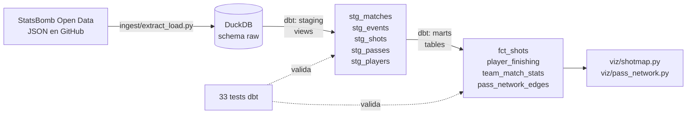
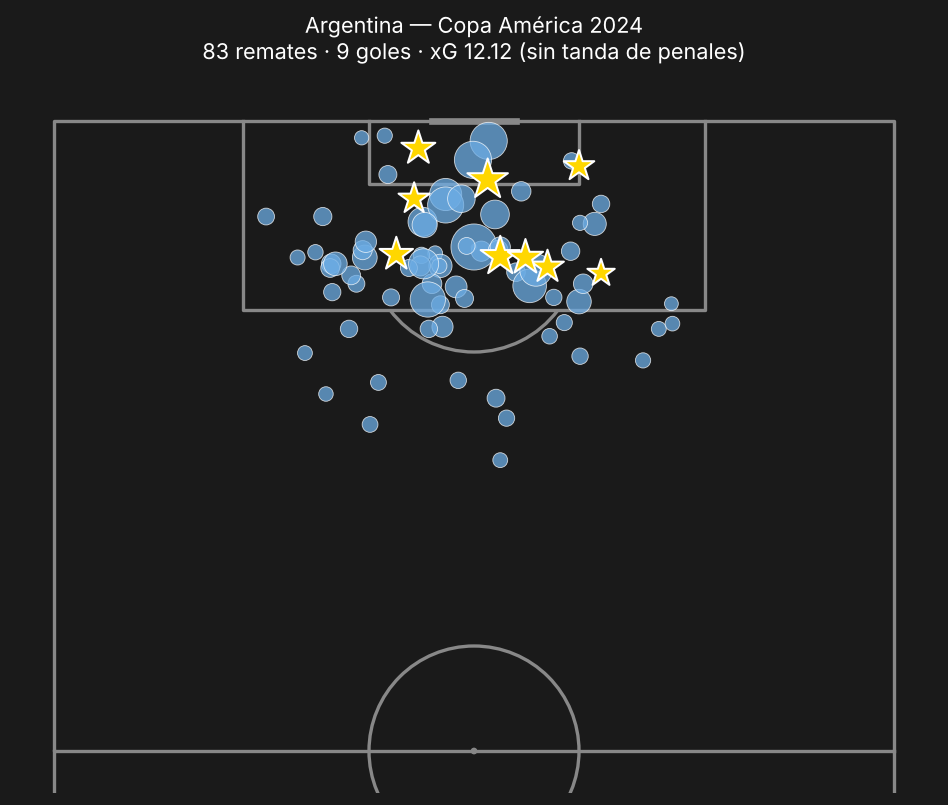
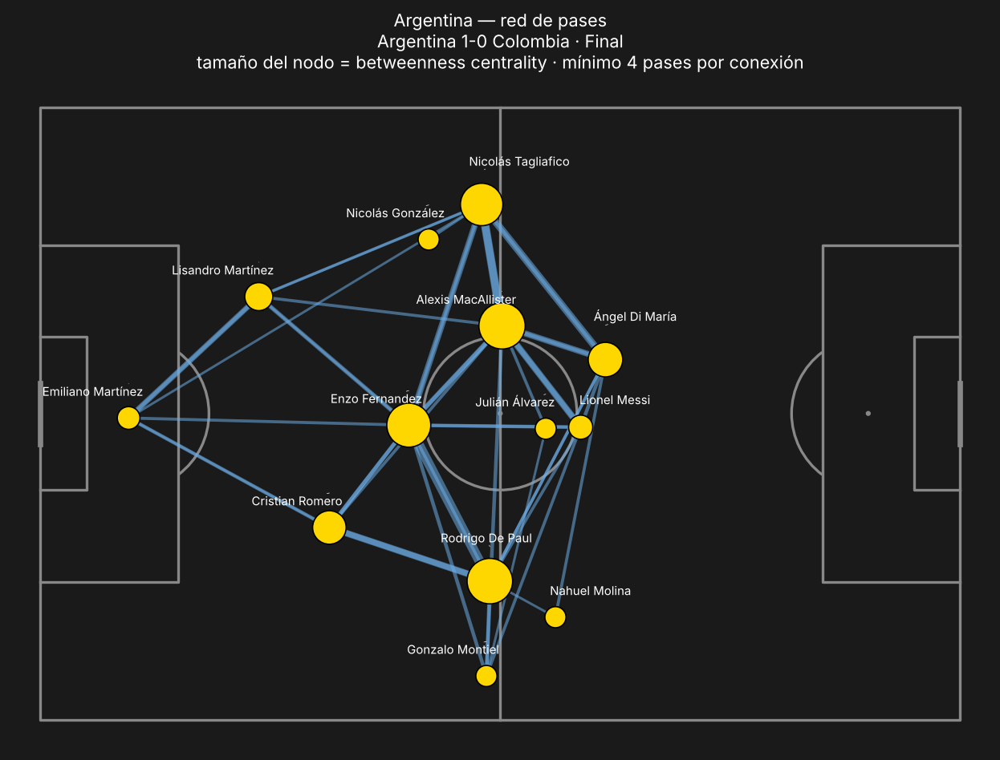

# ⚽ futbol-analytics-pipeline

Pipeline **ELT** de datos de fútbol: baja eventos de partidos de [StatsBomb Open Data](https://github.com/statsbomb/open-data), los carga crudos en **DuckDB**, los modela con **dbt** (staging → marts, con tests de calidad) y genera visualizaciones de análisis táctico. Incluye un workflow de **GitHub Actions** que corre el pipeline completo (ingesta + `dbt build` + gráficos).

*ELT pipeline for football event data: StatsBomb → DuckDB → dbt (tested models) → mplsoccer/networkx visualizations, with CI on GitHub Actions.*

Dataset por defecto: **Copa América 2024** — 32 partidos, ~100.000 eventos, 751 remates.

---

## Arquitectura



| Capa | Qué hay | Por qué |
|---|---|---|
| **raw** | JSON original, una fila por partido / evento / alineación | Si cambia la lógica, se re-transforma sin volver a descargar. Carga idempotente (`INSERT OR REPLACE`): re-correr no duplica. |
| **staging** | Vistas que extraen y tipan campos del JSON | Una sola fuente de verdad para nombres de columnas y tipos. |
| **marts** | Tablas listas para análisis | Lo que consume un analista o un dashboard. |

## Resultados (Copa América 2024)

### Shot map de Argentina
Tamaño = xG del remate · estrella = gol · sin tanda de penales.



### Red de pases — Final Argentina 1-0 Colombia
Nodo = posición promedio del jugador, tamaño = **betweenness centrality** (qué tanto pasa la circulación por ese jugador). Mac Allister, De Paul y Enzo Fernández fueron los "puentes" del equipo.



### Goleadores vs. xG (`marts.player_finishing`, sin penales)

| Jugador | Equipo | Remates | Goles | xG | Goles − xG |
|:--|:--|--:|--:|--:|--:|
| Lautaro Martínez | Argentina | 11 | 5 | 2.89 | +2.11 |
| Darwin Núñez | Uruguay | 21 | 2 | 1.86 | +0.14 |
| Julián Álvarez | Argentina | 9 | 2 | 1.54 | +0.46 |
| Salomón Rondón | Venezuela | 17 | 2 | 1.53 | +0.47 |

Lautaro convirtió más del doble de lo que "valían" sus remates; Darwin Núñez necesitó 21 remates para 2 goles.

## Calidad de datos

`dbt build` corre **33 tests**: unicidad y no-nulos de claves, integridad referencial (`stg_events.match_id → stg_matches`), un test genérico propio (`unique_combination`) y dos tests de negocio:

- `xg_between_0_and_1` — el xG es una probabilidad.
- `goals_match_scoreline` — **reconciliación**: goles de los eventos + goles en contra = resultado oficial de *cada* partido.

Ese último test encontró un bug real en la primera versión: los marts sumaban los penales de la **tanda** (period 5) como goles, y Uruguay aparecía con 19 goles en vez de 11. Se agregó `is_shootout` en `stg_shots` y se excluye en los marts.

Otro detalle: `networkx.betweenness_centrality` interpreta el peso como **distancia**. Si se le pasa "cantidad de pases", los jugadores que más se asocian quedan *más lejos*. Se usa `1 / pases`.

## Cómo correrlo

```bash
pip install -r requirements.txt
make all          # ingest + dbt build + gráficos
```

O por partes:

```bash
python ingest/extract_load.py                                  # Copa América 2024
python ingest/extract_load.py --competition 43 --season 106    # Mundial 2022
cd dbt_futbol && dbt build --profiles-dir . && cd ..
python viz/shotmap.py --team Colombia
python viz/pass_network.py --match 3943077 --team Colombia
```

Explorar los datos con SQL:

```bash
duckdb data/futbol.duckdb "select * from marts.team_match_stats order by xg desc limit 10"
```

## Estructura

```
ingest/extract_load.py      Extract + Load (sin transformar) a DuckDB
dbt_futbol/models/staging   vistas: parseo y tipado del JSON
dbt_futbol/models/marts     tablas de análisis
dbt_futbol/tests            tests de negocio (xG, reconciliación de goles)
viz/                        shot map y red de pases desde los marts
.github/workflows/ci.yml    pipeline completo en cada push + semanal
```

## Origen y próximos pasos

Empezó como dos scripts sueltos (shot map y red de pases de la final) que bajaban los datos con `statsbombpy` y graficaban todo en el mismo archivo. Lo separé en capas para poder sumar partidos y torneos sin reescribir el análisis.

- [ ] Liga Profesional Argentina (StatsBomb no la cubre): scraping de otra fuente para analizar a **Belgrano**.
- [ ] Modelo incremental en dbt para no re-procesar torneos ya cargados.
- [ ] Dashboard (Streamlit / Evidence) sobre los marts.

Datos: StatsBomb Open Data, uso no comercial con atribución a StatsBomb.
